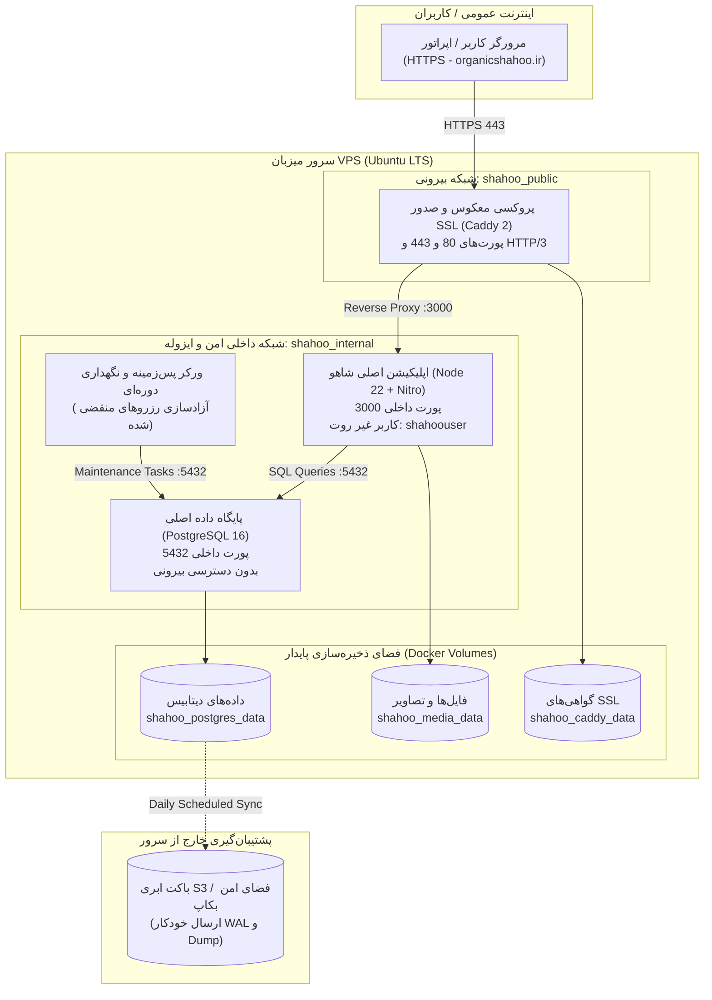

# معماری استقرار مستقل شاهو (SHAHOO Self-Hosting Architecture)

این سند نقشه جامع فنی، مرزهای امنیتی و معماری کانتینری فروشگاه شاهو را در حالت Self-Hosted مستقل از Vercel و Neon تشریح می‌کند.

---

## ۱. دیاگرام جریان ترافیک و مرزهای شبکه (System Topology)

---

## ۲. اصول و مرزهای امنیتی (Zero-Trust Security Principles)

1. **جداسازی کامل دیتابیس از وب:** پورت ۵۴۳۲ هیچ‌گاه به شبکه عمومی Bind نشده و صرفاً در شبکه داخلی `shahoo_internal` در دسترس اپلیکیشن است.
2. **اجرا با کاربر بدون دسترسی روت (`shahoouser` - UID 1001):** در ایمیج داکر، برنامه با کاربری کاملاً محدود اجرا می‌شود تا امکان فرار از کانتینر (Container Escape) به حداقل برسد.
3. **تفکیک کامل سکرت‌ها:** هیچ کلید یا رمزی در سورس گیت‌هاب یا ایمیج نهایی ذخیره نشده و صرفاً در لحظه اجرا از فایل `.env` بارگذاری می‌شود.
4. **ثبت لاگ ساختاریافته JSON:** تمام لاگ‌های دسترسی، تغییرات ادمین و تراکنش‌های بانکی دارای شناسه ردیابی (Correlation ID) بوده و اطلاعات کارت، پسورد یا OTP در لاگ‌ها ماسک می‌شوند.

---

## ۳. لایه انتزاع سرویس‌ها (Provider Neutrality)

فروشگاه شاهو طوری معماری شده که به هیچ سرویس ابری خاصی قفل نشود (No Vendor Lock-in):

* **فضای ذخیره‌سازی رسانه (Media Storage):** از طریق اینترفیس ماژولار `src/server/media/storage.ts`، سیستم هم با فایل‌سیستم محلی سرور (`disk`) و هم با باکت‌های سازگار با S3 (مانند آروان‌کلود، پارس‌پک، MinIO یا AWS) بدون تغییر در کد کار می‌کند.
* **دیتابیس:** از طریق Drizzle ORM و درایور استاندارد `pg`، برنامه مستقیماً با PostgreSQL 16 استاندارد بدون وابستگی به Neon ارتباط برقرار می‌کند.
* **درگاه پرداخت و پیامک:** از طریق ماشین حالت بادوام (Durable State Machine) برای PayPing و SMS.ir، فرآیندها در لایه دیتابیس با Idempotency Key ذخیره شده و از تراکنش تکراری یا ناهماهنگ جلوگیری می‌شود.

## 4. Implementation and verification boundary

This document describes the intended topology, not an already-running server. The Dockerfile/Compose files are source scaffolding. They still require `docker compose config`, an image build, a disposable PostgreSQL migration run, application/worker health checks, HTTPS issuance, and a restore drill before any Production cutover. The PostgreSQL port is intentionally not published to the host.

## 5. Database role separation

On a fresh Docker volume, `POSTGRES_USER` is the bootstrap/administrative role and `APP_DB_USER` is a separate non-superuser role. The application and worker connect only with `APP_DB_USER`; database backup/restore scripts use the administrative role. `scripts/init-db.sql` creates the application role and assigns the database/schema ownership during first initialization only.

Do not delete or recreate an existing database volume to apply this role split. Existing databases require a separately reviewed role/ownership migration.
